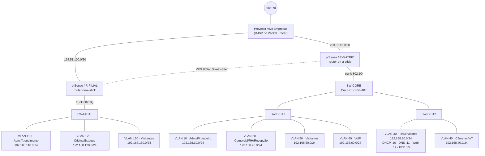

# AgroTech — Projeto de Infraestrutura e Serviços de Redes Corporativas

| | |
|---|---|
| **Instituição** | Pontifícia Universidade Católica de Goiás (PUC Goiás) — Escola Politécnica e de Artes |
| **Curso** | Engenharia de Computação |
| **Disciplina** | Redes de Computadores II — turma 2026.2-CIC1001/A02 |
| **Trabalho** | Projeto de Infraestrutura e Serviços de Redes Corporativas (N2) |
| **Integrantes** | Anna Clara Diniz · Ana Júlia Francelin |
| **Local e ano** | Goiânia – GO, 2026 |

## Resumo

Este repositório contém o projeto da rede corporativa da **AgroTech Soluções Agrícolas Ltda.**, empresa fictícia do agronegócio com matriz em Goiânia e filial em Anápolis (cerca de 40 funcionários e 100 dispositivos, com meta de 150). O trabalho reúne o levantamento de necessidades, o planejamento físico e lógico da infraestrutura (topologia em estrela, cabeamento UTP Cat6, firewall pfSense, switches gerenciáveis e Wi-Fi 6), a segmentação em **9 VLANs** com um **plano de endereçamento IP** completo, a simulação da rede no **Cisco Packet Tracer** (router-on-a-stick, DHCP relay, rotas estáticas entre unidades e ACL para visitantes) e a **implementação prática de serviços de rede com Docker**: **DHCP, DNS, Web e FTP**, todos testados, com evidências e scripts para reproduzir a solução.

## Sumário

1. [Caracterização da empresa](docs/01-empresa.md)
2. [Requisitos da rede](docs/02-requisitos.md)
3. [Planejamento da infraestrutura](docs/03-planejamento-infra.md) (esquema físico, esquema lógico, equipamentos, VLANs)
4. [Plano de endereçamento IP](docs/04-plano-ip.md)
5. [Serviços de rede com Docker](docs/05-servicos-docker.md)
6. [Testes e evidências](docs/06-testes-e-evidencias.md)
7. [Dificuldades e decisões técnicas](docs/07-dificuldades-e-decisoes.md)
- [Guia do Packet Tracer](packet-tracer/README.md) · [Configurações IOS](packet-tracer/configs/)
- [Diagramas draw.io](diagramas/)
- [Roteiro da apresentação](docs/roteiro-apresentacao.md)

## Visão geral da rede



## Plano de IP resumido

| VLAN | Unidade | Setor | Rede | Gateway | Pool DHCP |
|---|---|---|---|---|---|
| 10 | Matriz | Administrativo / Financeiro | 192.168.10.0/24 | 192.168.10.1 | .100 – .200 |
| 20 | Matriz | Comercial / RH / Recepção | 192.168.20.0/24 | 192.168.20.1 | .100 – .200 |
| 30 | Matriz | TI / Servidores | 192.168.30.0/24 | 192.168.30.1 | .100 – .200 |
| 40 | Matriz | Câmeras IP / IoT | 192.168.40.0/24 | 192.168.40.1 | .100 – .200 |
| 50 | Matriz | Wi-Fi Visitantes (só Internet) | 192.168.50.0/24 | 192.168.50.1 | .100 – .200 |
| 60 | Matriz | VoIP | 192.168.60.0/24 | 192.168.60.1 | .100 – .200 |
| 110 | Filial | Administrativo / Atendimento | 192.168.110.0/24 | 192.168.110.1 | .100 – .200 |
| 120 | Filial | Oficina / Estoque | 192.168.120.0/24 | 192.168.120.1 | .100 – .200 |
| 150 | Filial | Wi-Fi Visitantes (só Internet) | 192.168.150.0/24 | 192.168.150.1 | .100 – .200 |

**WAN:** matriz ↔ provedor 203.0.113.0/30 · provedor ↔ filial 198.51.100.0/30.
**Servidores (VLAN 30):** DHCP 192.168.30.10 · DNS 192.168.30.11 · Web 192.168.30.12 · FTP 192.168.30.13 · domínio `agrotech.local`.

## Como reproduzir os serviços Docker

Pré-requisitos: Windows com **Docker Desktop** aberto e **Git**.

```powershell
git clone https://github.com/<usuario>/agrotech-infraestrutura-redes.git
cd agrotech-infraestrutura-redes
powershell -ExecutionPolicy Bypass -File .\docker\scripts\testar-tudo.ps1
start http://localhost:8080
powershell -ExecutionPolicy Bypass -File .\docker\scripts\derrubar.ps1
```

O script sobe os quatro serviços e um cliente de teste, executa os testes de DHCP, DNS, Web e FTP, grava as saídas em [`evidencias/`](evidencias/) e mostra um resumo `PASSOU`/`FALHOU`. Resultado da última execução:

```
[PASSOU] DHCP (IP do pool .100-.200)
[PASSOU] DNS (intranet -> 192.168.30.12)
[PASSOU] Web (HTTP 200 no container e no host)
[PASSOU] FTP (listar, baixar, enviar, negar senha errada)
```

Detalhes e passo a passo manual em [docs/05-servicos-docker.md](docs/05-servicos-docker.md).

## Critérios de avaliação

| Critério | Peso | Onde está no repositório |
|---|---|---|
| Caracterização da empresa | 1,0 | [docs/01-empresa.md](docs/01-empresa.md) (nome, segmento, atividades, funcionários, setores, necessidades de conectividade) e [docs/02-requisitos.md](docs/02-requisitos.md) |
| Planejamento da infraestrutura | 2,0 | [docs/03-planejamento-infra.md](docs/03-planejamento-infra.md) (esquema físico e lógico, equipamentos, VLANs, racks), [diagramas/](diagramas/), [packet-tracer/](packet-tracer/) |
| Plano de endereçamento IP | 2,0 | [docs/04-plano-ip.md](docs/04-plano-ip.md) (redes, máscaras, gateways, pools, IPs fixos, distribuição por setor, WAN, justificativas) |
| Serviços de rede com Docker | 3,0 | [docker/](docker/) (DHCP, DNS, Web, FTP + cliente de teste), [docs/05-servicos-docker.md](docs/05-servicos-docker.md), [evidencias/](evidencias/) |
| Documentação e evidências | 1,0 | [docs/06-testes-e-evidencias.md](docs/06-testes-e-evidencias.md), [evidencias/](evidencias/), configs comentadas em [docker/](docker/) e [packet-tracer/configs/](packet-tracer/configs/), [docs/07-dificuldades-e-decisoes.md](docs/07-dificuldades-e-decisoes.md) |
| Apresentação | 1,0 | [docs/roteiro-apresentacao.md](docs/roteiro-apresentacao.md) |

## Limitações

- **DHCP no Docker Desktop:** no Windows, os containers rodam numa VM e a rede deles não alcança a rede física por broadcast. Por isso o DHCP é demonstrado **entre containers**, na rede `agrotech-lan` (que reproduz a VLAN 30). Em produção, o DHCP ficaria no servidor da VLAN 30 atendendo as demais VLANs via `ip helper-address`, o que é demonstrado no Packet Tracer.
- **VPN IPSec:** o projeto real usa VPN Site-to-Site entre dois pfSense, que não existem no Packet Tracer. Na simulação, matriz e filial se comunicam por rotas estáticas via provedor (e opcionalmente por túnel GRE). A configuração do IPSec está documentada.
- **Equipamentos no Packet Tracer:** pfSense, Cisco CBS350 e TP-Link são representados por roteadores Cisco 2911 e switches 2960, com os mesmos conceitos (VLAN, trunk, subinterfaces, ACL).
- **FTP:** funciona entre containers; não foi publicado para o Windows por causa do modo passivo. Em produção, o recomendado é SFTP.
- **Senhas de laboratório** (`AgroTech2026`, `agrotech123`) estão nos arquivos para permitir a reprodução; em produção ficariam fora do Git.

Discussão completa em [docs/07-dificuldades-e-decisoes.md](docs/07-dificuldades-e-decisoes.md).

## Estrutura do repositório

```
├── README.md
├── docs/            documentação do projeto (01 a 07) e roteiro da apresentação
├── diagramas/       fisico.drawio, logico.drawio (+ PNGs exportados)
├── packet-tracer/   guia passo a passo, configs IOS (configs/*.txt) e agrotech.pkt
├── docker/          docker-compose.yml, dhcp/, dns/, web/, ftp/, cliente/, scripts/
└── evidencias/      saídas dos testes (.txt) e prints/
```

## Checklist de entrega

- [x] Documentação (empresa, requisitos, infraestrutura, plano de IP, Docker, testes, decisões)
- [x] Serviços Docker implementados e testados (DHCP, DNS, Web, FTP)
- [x] Evidências em texto dos testes Docker (`evidencias/*.txt`)
- [x] Configurações IOS do Packet Tracer e guia passo a passo
- [x] Diagramas físico e lógico (`.drawio` e Mermaid)
- [x] Roteiro da apresentação
- [ ] Topologia montada no Packet Tracer e salva em `packet-tracer/agrotech.pkt`
- [ ] Prints do Packet Tracer em `evidencias/prints/pt-*.png`
- [ ] Prints do Docker em `evidencias/prints/docker-*.png`
- [ ] PNGs dos diagramas em `diagramas/`
- [ ] Ana Júlia adicionada como colaboradora
- [ ] Link do repositório entregue no AVA/Teams

## Licença

[MIT](LICENSE).
