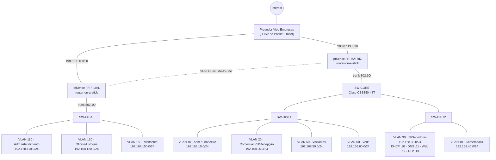

# AgroTech — Projeto de Infraestrutura e Serviços de Redes Corporativas

| | |
|---|---|
| **Instituição** | Pontifícia Universidade Católica de Goiás (PUC Goiás) — Escola Politécnica e de Artes |
| **Curso** | Engenharia de Computação |
| **Disciplina** | Redes de Computadores II — turma 2026.2-CIC1001/A02 |
| **Trabalho** | Projeto de Infraestrutura e Serviços de Redes Corporativas — trabalho em grupo, 30% da N2 |
| **Modalidade** | Atividade prática e projeto aplicado |
| **Integrantes** | Anna Clara Diniz · Ana Júlia Francelin |
| **Local e ano** | Goiânia – GO, 2026 |

## Resumo

Este repositório contém o **projeto lógico de infraestrutura de rede LAN corporativa** da **AgroTech Soluções Agrícolas Ltda.**, empresa fictícia do agronegócio (comércio de máquinas agrícolas, peças e assistência técnica) com matriz em Goiânia e filial em Anápolis, cerca de 40 funcionários e 100 dispositivos, com meta de 150. O projeto aplica conceitos de redes LAN, protocolos TCP/IP, endereçamento IP, segmentação de redes e serviços de infraestrutura:

- levantamento das necessidades de comunicação, conectividade e compartilhamento de recursos;
- diagramas físicos e lógicos (topologia em estrela, cabeamento UTP Cat6, firewall pfSense, switches gerenciáveis, Wi-Fi 6);
- segmentação em **9 VLANs** com plano de endereçamento IP completo;
- simulação da infraestrutura no **Cisco Packet Tracer**;
- **implementação prática de quatro serviços TCP/IP com Docker** (**DHCP, DNS, Web e FTP**), todos testados, com evidências e scripts para reproduzir a solução.

## Sumário

O sumário segue os **requisitos obrigatórios do enunciado**, na mesma ordem:

1. [Caracterização da empresa e levantamento de requisitos](docs/01-caracterizacao-da-empresa.md)
2. [Planejamento da infraestrutura de rede](docs/02-planejamento-da-infraestrutura.md): esquema físico, esquema lógico, equipamentos e segmentação; diagramas em [`diagramas/`](diagramas/)
3. [Plano de endereçamento IP e segmentação](docs/03-plano-de-enderecamento-ip.md)
4. [Configuração dos serviços de rede com Docker](docs/04-configuracao-dos-servicos-docker.md)
5. [Documentação e evidências](docs/05-documentacao-e-evidencias.md)
6. [Dificuldades e decisões técnicas](docs/06-dificuldades-e-decisoes-tecnicas.md)

Complementos: [simulação no Packet Tracer](packet-tracer/README.md) · [configurações IOS](packet-tracer/configs/) · [roteiro da apresentação](docs/roteiro-apresentacao.md)

## Requisitos obrigatórios do enunciado × onde estão atendidos

| Requisito do enunciado | Onde está |
|---|---|
| **1. Caracterização da empresa** | |
| Nome e segmento de atuação da empresa fictícia | [Doc 1, seção 1.1](docs/01-caracterizacao-da-empresa.md#11-identificação) |
| Descrição das atividades desenvolvidas | [Doc 1, seção 1.2](docs/01-caracterizacao-da-empresa.md#12-atividades) |
| Quantidade estimada de funcionários e setores | [Doc 1, seção 1.3](docs/01-caracterizacao-da-empresa.md#13-funcionários-e-setores) |
| Levantamento das necessidades de conectividade e comunicação | [Doc 1, seções 1.4 e 1.5](docs/01-caracterizacao-da-empresa.md#14-levantamento-de-necessidades-de-conectividade-e-comunicação) |
| **2. Planejamento da infraestrutura de rede** | |
| Elaboração do esquema físico da rede | [Doc 2, seção 2.2](docs/02-planejamento-da-infraestrutura.md#22-esquema-físico) · [`diagramas/fisico.drawio`](diagramas/fisico.drawio) / [`fisico.png`](diagramas/fisico.png) |
| Elaboração do esquema lógico da rede | [Doc 2, seção 2.3](docs/02-planejamento-da-infraestrutura.md#23-esquema-lógico) · [`diagramas/logico.drawio`](diagramas/logico.drawio) / [`logico.png`](diagramas/logico.png) |
| Identificação dos equipamentos necessários (switches, roteadores, servidores, computadores etc.) | [Doc 2, seção 2.4](docs/02-planejamento-da-infraestrutura.md#24-equipamentos-necessários) |
| Definição da segmentação lógica (VLANs ou sub-redes) | [Doc 2, seção 2.6](docs/02-planejamento-da-infraestrutura.md#26-segmentação-lógica-vlans) |
| **3. Plano de endereçamento IP** | |
| Definição das redes e sub-redes | [Doc 3, seções 3.3 a 3.5](docs/03-plano-de-enderecamento-ip.md#33-matriz-goiânia) |
| Endereços IP e máscaras de rede | [Doc 3, seções 3.2 a 3.6](docs/03-plano-de-enderecamento-ip.md#32-máscara-24-cálculo) |
| Identificação dos gateways | [Doc 3, seções 3.3 e 3.4](docs/03-plano-de-enderecamento-ip.md#33-matriz-goiânia) |
| Distribuição dos endereços IP por setor ou departamento | [Doc 3, seção 3.7](docs/03-plano-de-enderecamento-ip.md#37-distribuição-por-setor) |
| **4. Configuração dos serviços de rede (Docker, pelo menos dois)** | |
| DHCP — distribuição automática de endereços IP | [`docker/dhcp/`](docker/dhcp/) · [evidência](evidencias/teste-dhcp.txt) |
| DNS — resolução de nomes | [`docker/dns/`](docker/dns/) · [evidência](evidencias/teste-dns.txt) |
| Servidor Web — hospedagem de uma página interna | [`docker/web/`](docker/web/) · [evidência](evidencias/teste-web.txt) |
| Servidor FTP — transferência de arquivos | [`docker/ftp/`](docker/ftp/) · [evidência](evidencias/teste-ftp.txt) |
| **5. Documentação e evidências** | |
| Descrição das configurações realizadas | [Doc 4, seção 4.5](docs/04-configuracao-dos-servicos-docker.md#45-explicação-das-configurações) · [guia do Packet Tracer](packet-tracer/README.md) |
| Imagens ou capturas de tela dos serviços em funcionamento | [Doc 5](docs/05-documentacao-e-evidencias.md) · [`evidencias/prints/`](evidencias/prints/) |
| Arquivos de configuração e comandos utilizados | [`docker/`](docker/) · [`packet-tracer/configs/`](packet-tracer/configs/) · [Doc 4, seção 4.4](docs/04-configuracao-dos-servicos-docker.md#44-como-reproduzir-do-zero) |
| Explicação das soluções adotadas | [Doc 6](docs/06-dificuldades-e-decisoes-tecnicas.md) |

## Visão geral da rede



## Plano de IP resumido

| VLAN | Unidade | Setor | Rede | Gateway | Pool DHCP |
|---|---|---|---|---|---|
| 10 | Matriz | Administrativo / Financeiro | 192.168.10.0/24 | 192.168.10.1 | .100 – .200 |
| 20 | Matriz | Comercial / RH / Recepção | 192.168.20.0/24 | 192.168.20.1 | .100 – .200 |
| 30 | Matriz | TI / Servidores | 192.168.30.0/24 | 192.168.30.1 | .100 – .200 |
| 40 | Matriz | Câmeras IP / IoT | 192.168.40.0/24 | 192.168.40.1 | .100 – .200 |
| 50 | Matriz | Wi-Fi Visitantes (só Internet) | 192.168.50.0/24 | 192.168.50.1 | .100 – .200 |
| 60 | Matriz | VoIP | 192.168.60.0/24 | 192.168.60.1 | .100 – .200 |
| 110 | Filial | Administrativo / Atendimento | 192.168.110.0/24 | 192.168.110.1 | .100 – .200 |
| 120 | Filial | Oficina / Estoque | 192.168.120.0/24 | 192.168.120.1 | .100 – .200 |
| 150 | Filial | Wi-Fi Visitantes (só Internet) | 192.168.150.0/24 | 192.168.150.1 | .100 – .200 |

**WAN:** matriz ↔ provedor 203.0.113.0/30 · provedor ↔ filial 198.51.100.0/30.
**Servidores (VLAN 30):** DHCP 192.168.30.10 · DNS 192.168.30.11 · Web 192.168.30.12 · FTP 192.168.30.13 · domínio `agrotech.local`.

## Como reproduzir os serviços Docker

Pré-requisitos: Windows com **Docker Desktop** aberto e **Git**.

```powershell
git clone https://github.com/annacdiniz-dev/agrotech-infraestrutura-redes.git
cd agrotech-infraestrutura-redes
powershell -ExecutionPolicy Bypass -File .\docker\scripts\testar-tudo.ps1
start http://localhost:8080
powershell -ExecutionPolicy Bypass -File .\docker\scripts\derrubar.ps1
```

O script sobe os quatro serviços e um cliente de teste, executa os testes de DHCP, DNS, Web e FTP, grava as saídas em [`evidencias/`](evidencias/) e mostra um resumo `PASSOU`/`FALHOU`. Resultado da última execução:

```
[PASSOU] DHCP (IP do pool .100-.200)
[PASSOU] DNS (intranet -> 192.168.30.12)
[PASSOU] Web (HTTP 200 no container e no host)
[PASSOU] FTP (listar, baixar, enviar, negar senha errada)
```

Detalhes e passo a passo manual em [docs/04-configuracao-dos-servicos-docker.md](docs/04-configuracao-dos-servicos-docker.md).

## Critérios de avaliação

| Critério (como no enunciado) | Pontuação | Onde está no repositório |
|---|---|---|
| Caracterização da empresa e levantamento de requisitos | 1,0 | [Doc 1](docs/01-caracterizacao-da-empresa.md): identificação, atividades, funcionários e setores, necessidades de conectividade, requisitos (desempenho, disponibilidade, escalabilidade, segurança, gerenciamento) |
| Diagramas físicos e lógicos da rede | 2,0 | [`diagramas/`](diagramas/) (draw.io + PNG: plantas, cabeamento, racks, VLANs) · diagramas Mermaid no [Doc 2](docs/02-planejamento-da-infraestrutura.md) · topologia no [Packet Tracer](packet-tracer/) |
| Plano de endereçamento IP e segmentação | 2,0 | [Doc 3](docs/03-plano-de-enderecamento-ip.md) (redes, máscaras, gateways, pools DHCP, IPs fixos, distribuição por setor, WAN) · VLANs no [Doc 2, seção 2.6](docs/02-planejamento-da-infraestrutura.md#26-segmentação-lógica-vlans) |
| Implementação dos serviços TCP/IP com Docker | 3,0 | [`docker/`](docker/) (DHCP, DNS, Web, FTP + cliente de teste) · [Doc 4](docs/04-configuracao-dos-servicos-docker.md) · [`evidencias/`](evidencias/) |
| Documentação e organização do projeto | 1,0 | [Doc 5](docs/05-documentacao-e-evidencias.md) · [Doc 6](docs/06-dificuldades-e-decisoes-tecnicas.md) · configs comentadas em [`docker/`](docker/) e [`packet-tracer/configs/`](packet-tracer/configs/) · este README |
| Apresentação e domínio técnico dos integrantes | 1,0 | [Roteiro da apresentação](docs/roteiro-apresentacao.md) (participação das duas integrantes + perguntas e respostas para estudo) |
| **Total** | **10,0** | |

## Limitações

- **DHCP no Docker Desktop:** no Windows, os containers rodam numa VM e a rede deles não alcança a rede física por broadcast. Por isso o DHCP é demonstrado **entre containers**, na rede `agrotech-lan` (que reproduz a VLAN 30). Em produção, o DHCP ficaria no servidor da VLAN 30 atendendo as demais VLANs via `ip helper-address`, o que é demonstrado no Packet Tracer.
- **VPN IPSec:** o projeto real usa VPN Site-to-Site entre dois pfSense, que não existem no Packet Tracer. Na simulação, matriz e filial se comunicam por rotas estáticas via provedor (e opcionalmente por túnel GRE). A configuração do IPSec está documentada.
- **Equipamentos no Packet Tracer:** pfSense, Cisco CBS350 e TP-Link são representados por roteadores Cisco 2911 e switches 2960, com os mesmos conceitos (VLAN, trunk, subinterfaces, ACL).
- **FTP:** funciona entre containers; não foi publicado para o Windows por causa do modo passivo. Em produção, o recomendado é SFTP.
- **Senhas de laboratório** (`AgroTech2026`, `agrotech123`) estão nos arquivos para permitir a reprodução; em produção ficariam fora do Git.

Discussão completa em [docs/06-dificuldades-e-decisoes-tecnicas.md](docs/06-dificuldades-e-decisoes-tecnicas.md).

## Estrutura do repositório

```
├── README.md
├── docs/            documentação (01 a 06, na ordem dos requisitos do enunciado) e roteiro da apresentação
├── diagramas/       fisico.drawio, logico.drawio (+ PNGs exportados)
├── packet-tracer/   guia passo a passo, configs IOS (configs/*.txt) e agrotech.pkt
├── docker/          docker-compose.yml, dhcp/, dns/, web/, ftp/, cliente/, scripts/
└── evidencias/      saídas dos testes (.txt) e prints/
```

## Checklist de entrega

- [x] Documentação (empresa, requisitos, infraestrutura, plano de IP, Docker, testes, decisões)
- [x] Serviços Docker implementados e testados (DHCP, DNS, Web, FTP)
- [x] Evidências em texto dos testes Docker (`evidencias/*.txt`)
- [x] Configurações IOS do Packet Tracer e guia passo a passo
- [x] Diagramas físico e lógico (`.drawio` e Mermaid)
- [x] Roteiro da apresentação
- [ ] Topologia montada no Packet Tracer e salva em `packet-tracer/agrotech.pkt`
- [ ] Prints do Packet Tracer em `evidencias/prints/pt-*.png`
- [ ] Prints do Docker em `evidencias/prints/docker-*.png`
- [ ] PNGs dos diagramas em `diagramas/`
- [ ] Ana Júlia adicionada como colaboradora
- [ ] Repositório **público** (conferido numa aba anônima)
- [ ] Link público do repositório informado no AVA/Teams (entrega conforme a data de apresentação; apresentações de 02 a 04/12/2026)

## Licença

[MIT](LICENSE).
