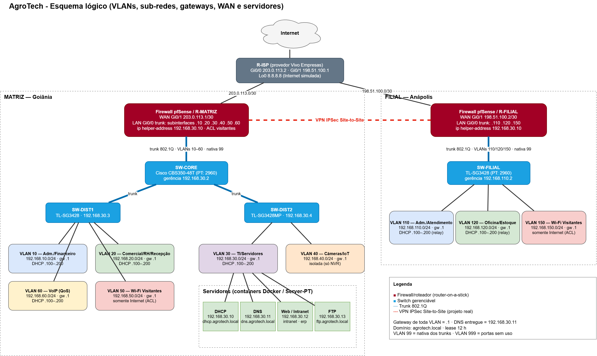
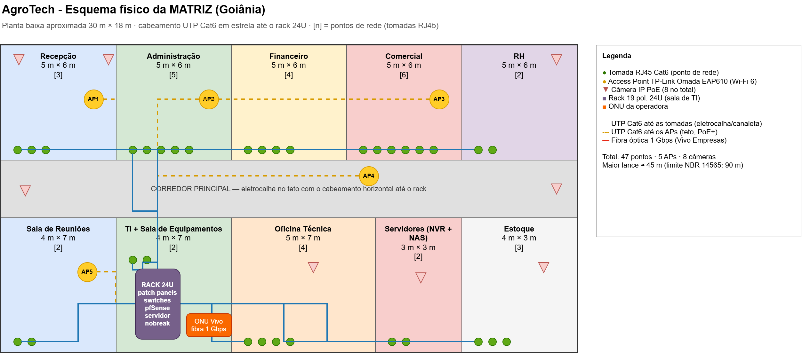
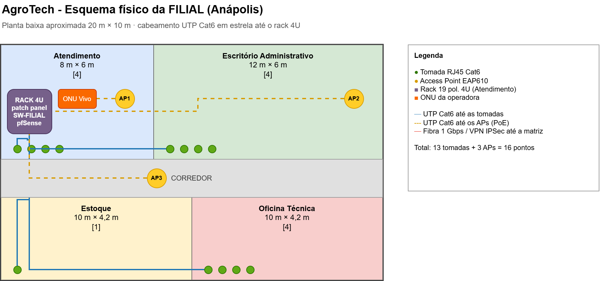
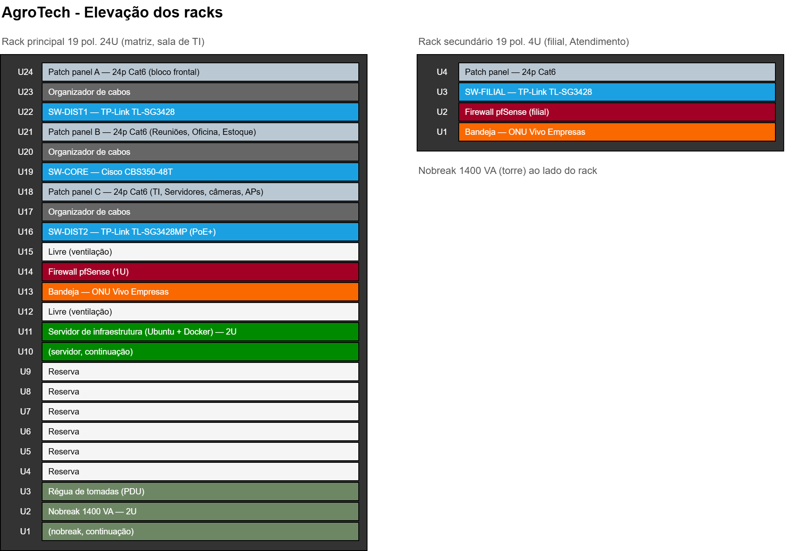

# Diagramas

| Arquivo | Conteúdo |
|---|---|
| [`fisico.drawio`](fisico.drawio) | 3 páginas: planta e cabeamento da **matriz**, planta e cabeamento da **filial**, elevação dos **racks 24U e 4U** |
| [`logico.drawio`](logico.drawio) | VLANs, sub-redes, gateways, trunks, WAN, VPN e servidores |
| [`fisico-matriz.png`](fisico-matriz.png) | Página *Matriz* do físico, em imagem |
| [`fisico-filial.png`](fisico-filial.png) | Página *Filial* do físico, em imagem |
| [`fisico-racks.png`](fisico-racks.png) | Página *Racks* do físico, em imagem |
| [`logico.png`](logico.png) | Esquema lógico, em imagem |

As versões em **Mermaid** dos mesmos diagramas aparecem direto no GitHub em [`docs/02-planejamento-da-infraestrutura.md`](../docs/02-planejamento-da-infraestrutura.md).

## Pré-visualização

## Como abrir e editar no draw.io

1. Acesse <https://app.diagrams.net>.
2. Menu **Ficheiro → Abrir de → Aparelho...** e selecione `diagramas/fisico.drawio` (ou `logico.drawio`). Se perguntar, escolha **Abrir na janela atual**.
3. O físico tem 3 páginas; troque de página na lista que fica na barra inferior.
4. Para mover um elemento, clique e arraste; as linhas de cabo se redesenham sozinhas.

## Como exportar as imagens (PNG)

Uma página por vez:

1. **Ficheiro → Exportar...** → aba **PNG**.
2. Opções: **Conteúdo** = Página atual · **Tamanho** = **2×** · **Aparência** = **Claro** · **Fundo Transparente** desmarcado.
3. **Exportar PNG** → nome do ficheiro conforme a tabela acima (só `.png`, sem `.drawio` no meio) → **Onde** = Descarregar.
4. Mova o arquivo da pasta Downloads para esta pasta `diagramas/`.
