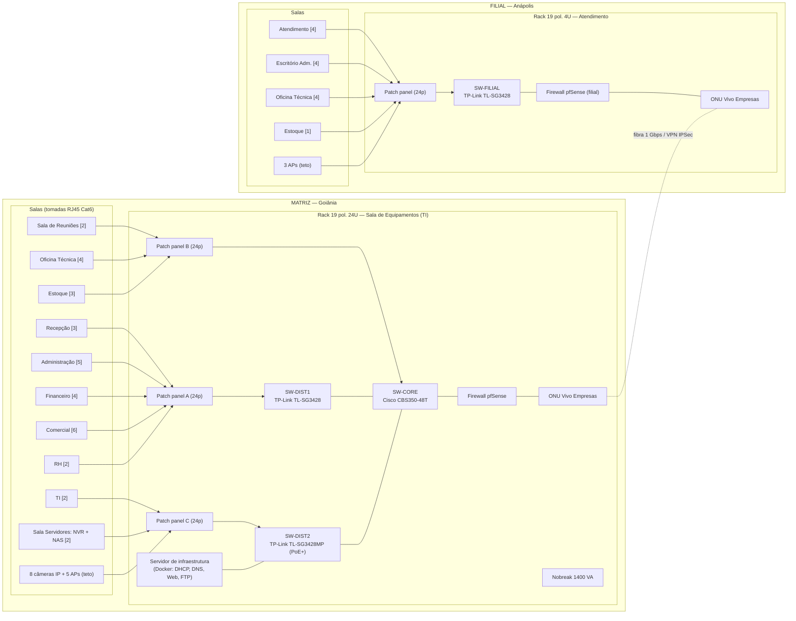
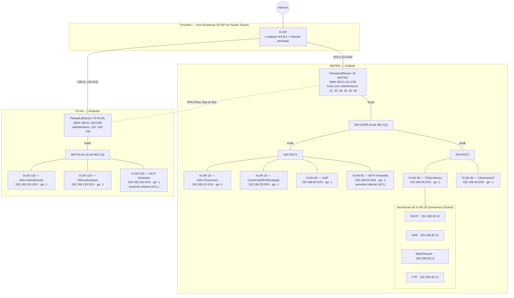

# 3. Planejamento da infraestrutura

## 3.1 Visão geral

A rede da AgroTech segue o **modelo hierárquico** de projeto de redes, em versão compacta adequada a uma empresa de médio porte:

| Camada | Função | Equipamento (projeto real) | Equipamento (Packet Tracer) |
|---|---|---|---|
| Borda / roteamento | Internet, VPN, firewall, roteamento entre VLANs | Firewall pfSense | Roteador Cisco 2911 (R-MATRIZ, R-FILIAL) |
| Núcleo (*core*) | Concentra os switches e leva todas as VLANs até o firewall | Cisco CBS350-48T | Switch 2960 (SW-CORE) |
| Distribuição / acesso | Liga os dispositivos finais às VLANs | TP-Link TL-SG3428 / TL-SG3428MP | Switch 2960 (SW-DIST1, SW-DIST2, SW-FILIAL) |

A **topologia física é em estrela**: cada ponto de rede tem um cabo exclusivo até o rack, e os switches de distribuição se ligam ao switch core. Uma falha de cabo afeta só um ponto, e a manutenção é centralizada na sala de equipamentos.

O **roteamento entre VLANs** é feito no modelo **router-on-a-stick**: o firewall (no PT, o roteador) recebe um único cabo *trunk* 802.1Q do switch core e tem uma subinterface por VLAN, que funciona como gateway (`.1`) daquela rede. Assim, todo tráfego entre setores passa pelo firewall e pode ser filtrado.

---

## 3.2 Esquema físico

### Planta baixa da matriz (Goiânia), cerca de 30 m × 18 m

Os números entre colchetes indicam a quantidade de **pontos de rede (tomadas RJ45)** em cada sala. `AP` indica um access point no teto.

```
┌──────────────┬──────────────┬──────────────┬──────────────┬──────────────┐
│  RECEPÇÃO    │ ADMINISTRAÇÃO│  FINANCEIRO  │  COMERCIAL   │     RH       │
│  5 x 6 m     │  5 x 6 m     │  5 x 6 m     │  5 x 6 m     │  5 x 6 m     │
│  [3]  AP1    │  [5]  AP2    │  [4]         │  [6]  AP3    │  [2]         │
├──────────────┴──────────────┴──────────────┴──────────────┴──────────────┤
│                     CORREDOR PRINCIPAL      AP4                          │
│        (eletrocalha no teto com o cabeamento horizontal até o rack)      │
├──────────────┬──────────────┬──────────────┬──────────────┬──────────────┤
│ SALA DE      │ TI + SALA DE │  OFICINA     │ SERVIDORES   │  ESTOQUE     │
│ REUNIÕES     │ EQUIPAMENTOS │  TÉCNICA     │ 3 x 3 m      │  4 x 3 m     │
│ 4 x 7 m      │ 4 x 7 m      │  5 x 7 m     │ NVR + NAS    │  [3]         │
│ [2]  AP5     │ RACK 24U [2] │  [4]         │ [2]          │              │
└──────────────┴──────────────┴──────────────┴──────────────┴──────────────┘
  Câmeras IP: 8 pontos no teto (entrada, recepção, corredor, oficina, estoque, pátio)
```

### Planta baixa da filial (Anápolis), cerca de 20 m × 10 m

```
┌───────────────────────────────┬────────────────────────────────────────────┐
│ ATENDIMENTO   8 x 6 m         │ ESCRITÓRIO ADMINISTRATIVO   12 x 6 m       │
│ RACK 4U   [4]   AP1           │ [4]   AP2                                  │
├───────────────────────────────┴────────────────────────────────────────────┤
│                              CORREDOR                                      │
├───────────────────────────────┬────────────────────────────────────────────┤
│ ESTOQUE   10 x 4,2 m          │ OFICINA TÉCNICA   10 x 4,2 m               │
│ [1]                AP3 (divisa)│ [4]                                        │
└───────────────────────────────┴────────────────────────────────────────────┘
```

### Diagrama físico (cabeamento até os racks)



### Sala de equipamentos e racks

A sala de equipamentos fica na sala de **TI** da matriz, com acesso restrito (porta com chave, apenas a equipe de TI), tomadas exclusivas aterradas e climatização. A distância do rack até o ponto mais distante (RH, extremo oposto do prédio) é de cerca de 45 m de cabo, dentro do limite de **90 m** do canal permanente da ABNT NBR 14565.

**Rack principal — 19", 24U, fechado (matriz):**

| Posição | Equipamento |
|---|---|
| U24 | Patch panel A — 24 portas Cat6 (bloco frontal: Recepção, Adm., Financeiro, Comercial, RH) |
| U23 | Organizador de cabos |
| U22 | SW-DIST1 — TP-Link TL-SG3428 |
| U21 | Patch panel B — 24 portas Cat6 (Reuniões, Oficina, Estoque) |
| U20 | Organizador de cabos |
| U19 | SW-CORE — Cisco CBS350-48T |
| U18 | Patch panel C — 24 portas Cat6 (TI, sala de Servidores, câmeras, APs) |
| U17 | Organizador de cabos |
| U16 | SW-DIST2 — TP-Link TL-SG3428MP (PoE+ para câmeras e APs) |
| U15 | Livre (ventilação) |
| U14 | Firewall pfSense (appliance 1U) |
| U13 | Bandeja com a ONU da operadora |
| U12 | Livre (ventilação) |
| U11–U10 | Servidor de infraestrutura (Ubuntu Server + Docker) |
| U9–U4 | Reserva para expansão |
| U3 | Régua de tomadas (PDU) |
| U2–U1 | Nobreak 1400 VA (rack) |

**Rack secundário — 19", 4U (filial), no Atendimento:**

| Posição | Equipamento |
|---|---|
| U4 | Patch panel — 24 portas Cat6 |
| U3 | SW-FILIAL — TP-Link TL-SG3428 |
| U2 | Firewall pfSense (filial) |
| U1 | Bandeja com a ONU da operadora |
| (ao lado) | Nobreak 1400 VA (torre) |

### Cabeamento

Seguindo a ABNT NBR 14565:

- **Cabo:** UTP Cat6, 4 pares, atenuação máxima de 19,8 dB/100 m a 100 MHz; suporta 1000BASE-T.
- **Conectorização:** padrão **T568B** nas duas pontas (tomadas fêmea Cat6 e patch panels).
- **Encaminhamento:** cabos horizontais pelo teto em eletrocalha/eletroduto ao longo do corredor; descidas até as tomadas em canaleta de PVC; APs e câmeras alimentados por PoE+ a partir do SW-DIST2.
- **Patch cords:** Cat6 de 1,5 m entre patch panel e switch, e entre tomada e dispositivo.
- **Identificação:** cada tomada e porta de patch panel é etiquetada (ex.: `PPA-05 / ADM-02`).
- **Testes de aceitação:** mapa de fiação, continuidade, certificação (atenuação, NEXT, FEXT, *return loss*) e teste de conectividade de todos os pontos.
- **Estimativa de cabo:** 63 pontos × cerca de 30 m em média ≈ 1.900 m, ou seja, **7 caixas de 305 m**.

---

## 3.3 Esquema lógico



**Fluxos importantes:**

- **DHCP:** um PC da VLAN 10 envia DHCPDISCOVER em *broadcast*. O firewall/roteador, que tem `ip helper-address 192.168.30.10` na subinterface .10, transforma esse broadcast em um pacote *unicast* para o servidor DHCP, informando a rede de origem (campo *giaddr* = 192.168.10.1). O servidor escolhe o pool da VLAN 10 e responde. O mesmo vale para a filial, com o pedido atravessando a WAN.
- **DNS:** todos os clientes recebem o DNS 192.168.30.11 pelo DHCP. Nomes `*.agrotech.local` são respondidos localmente; o resto é encaminhado para 8.8.8.8 e 1.1.1.1.
- **Matriz ↔ filial:** em produção, pela VPN IPSec entre os dois pfSense. No Packet Tracer, por rotas estáticas através do R-ISP (opcionalmente, por um túnel GRE).

---

## 3.4 Equipamentos necessários

| Equipamento | Modelo (projeto real) | Qtd. | Local | Justificativa |
|---|---|---|---|---|
| Firewall / roteador da matriz | pfSense em appliance 1U | 1 | Rack 24U | Filtragem *stateful*, roteamento entre VLANs, VPN IPSec, sem custo de licença |
| Firewall / roteador da filial | pfSense em appliance compacto | 1 | Rack 4U | Outra ponta da VPN Site-to-Site e gateway das VLANs da filial |
| Switch core | Cisco CBS350-48T | 1 | Rack 24U | 48 portas Gigabit gerenciáveis, VLAN 802.1Q, RSTP, QoS, SNMP |
| Switch de distribuição/acesso | TP-Link TL-SG3428 | 2 | Rack 24U (SW-DIST1) e rack 4U (SW-FILIAL) | 24 portas Gigabit + 4 SFP, gerenciável (VLAN, STP, QoS, SNMP) |
| Switch de distribuição/acesso PoE+ | TP-Link TL-SG3428MP | 1 | Rack 24U (SW-DIST2) | Mesmo modelo, com PoE+ para alimentar câmeras e APs pelo cabo de rede |
| Access point Wi-Fi 6 | TP-Link Omada EAP610 | 8 (5 matriz, 3 filial) | Teto | Wi-Fi 6, WPA3, múltiplos SSIDs por VLAN, gerência centralizada |
| Servidor de infraestrutura | Servidor rack 2U, 32 GB RAM, SSD, Ubuntu Server 24.04 + Docker | 1 | Rack 24U | Hospeda DHCP, DNS, Web/Intranet, FTP (e futuramente ERP, Omada Controller e monitoramento SNMP) em containers |
| Armazenamento de backup | NAS de 2 baias (RAID 1) | 1 | Sala de Servidores | Backup diário automatizado |
| Gravador de câmeras | NVR 16 canais | 1 | Sala de Servidores | Gravação das 8 câmeras, com folga |
| Câmeras IP | Câmera IP PoE | 8 | Matriz | Monitoramento patrimonial |
| Computadores | Desktop corporativo | 35 (25 matriz, 10 filial) | Setores | Estações de trabalho com placa Gigabit |
| Impressoras de rede | Multifuncional laser com Ethernet | 8 (5 matriz, 3 filial) | Setores | Impressão em rede por setor |
| Telefones IP | Telefone IP com switch interno (2 portas) | 27 (21 matriz, 6 filial) | Setores | Telefonia IP; o PC liga atrás do telefone |
| Rack | 19", 24U fechado / 19", 4U | 1 + 1 | Matriz / filial | Organização e proteção dos ativos |
| Patch panel | Cat6, 24 portas | 4 (3 matriz, 1 filial) | Racks | Terminação do cabeamento horizontal |
| Nobreak | 1400 VA | 2 | Racks | Proteção contra quedas de energia |
| Cabeamento | UTP Cat6, tomadas RJ45, patch cords, canaletas, eletrodutos | — | Prédios | Ver [cabeamento](#cabeamento) |

---

## 3.5 Ocupação de portas dos switches

| Switch | Portas | Conectados | Uplinks | Livres | Observação |
|---|---|---|---|---|---|
| SW-CORE (CBS350-48T) | 48 | 9 (Reuniões, Oficina, Estoque) | 3 (firewall, SW-DIST1, SW-DIST2) | 36 | Principal reserva para expansão |
| SW-DIST1 (TL-SG3428) | 24 + 4 SFP | 20 (bloco frontal) | 1 | 3 + 4 SFP | Comporta mais um switch empilhado via SFP |
| SW-DIST2 (TL-SG3428MP) | 24 + 4 SFP | 18 (TI, servidor, NAS, NVR, 8 câmeras, 5 APs) | 1 | 5 + 4 SFP | PoE+ para câmeras e APs |
| SW-FILIAL (TL-SG3428) | 24 + 4 SFP | 16 | 1 | 7 + 4 SFP | — |

Com cerca de 50 portas livres no total, a rede comporta o crescimento para 150 dispositivos (boa parte do crescimento é Wi-Fi e telefones atrás de PCs, que não ocupam portas extras).

---

## 3.6 Segmentação lógica (VLANs)

| VLAN | Nome | Unidade | Setores | Sub-rede |
|---|---|---|---|---|
| 10 | ADM-FINANCEIRO | Matriz | Administração, Financeiro | 192.168.10.0/24 |
| 20 | COMERCIAL-RH | Matriz | Comercial, RH, Recepção, Sala de Reuniões, Oficina, Estoque, Wi-Fi corporativo | 192.168.20.0/24 |
| 30 | TI-SERVIDORES | Matriz | TI, servidores, gerência dos equipamentos de rede | 192.168.30.0/24 |
| 40 | CAMERAS-IOT | Matriz | Câmeras IP, NVR | 192.168.40.0/24 |
| 50 | WIFI-VISITANTES | Matriz | Wi-Fi de visitantes | 192.168.50.0/24 |
| 60 | VOIP | Matriz | Telefones IP | 192.168.60.0/24 |
| 110 | ADM-ATENDIMENTO | Filial | Atendimento, Escritório Administrativo | 192.168.110.0/24 |
| 120 | OFICINA-ESTOQUE | Filial | Oficina Técnica, Estoque | 192.168.120.0/24 |
| 150 | WIFI-VISITANTES | Filial | Wi-Fi de visitantes | 192.168.150.0/24 |
| 99 | NATIVA | Ambas | VLAN nativa dos trunks (sem hosts) | — |
| 999 | PORTAS-NAO-USADAS | Ambas | Portas desligadas | — |

Por que separar assim: Administração e Financeiro lidam com dados financeiros e ficam isolados do restante; o RH, apesar de sigiloso, compartilha a VLAN 20 com o Comercial por ter apenas 2 estações, e o acesso aos dados do RH é controlado no próprio ERP. Câmeras e visitantes são os segmentos de maior risco e ficam totalmente isolados. Voz tem VLAN própria para receber prioridade (QoS). O endereçamento completo está em [04 — Plano de IP](04-plano-ip.md).

---

## 3.7 Projeto real × simulação

O Packet Tracer e o Docker Desktop têm limitações. A tabela mostra como cada elemento do projeto real foi representado:

| Elemento do projeto real | Representação na simulação | Motivo |
|---|---|---|
| Firewall pfSense (matriz e filial) | Roteadores Cisco 2911 com subinterfaces e ACL | O PT não tem pfSense; o conceito (router-on-a-stick + filtragem) é o mesmo |
| Cisco CBS350-48T / TP-Link TL-SG3428 | Switch Cisco 2960-24TT | Modelos disponíveis no PT; mesmos recursos usados (VLAN, trunk, RSTP) |
| VPN IPSec Site-to-Site | Rotas estáticas via R-ISP (e túnel GRE opcional) | VPN IPSec entre pfSense não é simulável no PT. Ver [07 — Decisões](07-dificuldades-e-decisoes.md) |
| Internet | Loopback 8.8.8.8 no R-ISP | Destino externo para testar a navegação dos visitantes |
| Servidor de infraestrutura com 4 containers | 4 Server-PT (SRV-DHCP, SRV-DNS, SRV-WEB, SRV-FTP) com os mesmos IPs | No PT cada serviço vira um servidor; no Docker, cada um é um container |
| APs com vários SSIDs (corporativo na VLAN 20 + visitantes na VLAN 50) em porta trunk | AccessPoint-PT em porta access da VLAN 50 | O AccessPoint-PT não faz *tagging* de VLAN; simulamos só o SSID de visitantes |
| Telefone IP com o PC ligado atrás (voice VLAN) | Telefone em porta própria da VLAN 60 | Simplifica a simulação |
| Um PC por setor | Um dispositivo representando cada VLAN | Suficiente para provar DHCP, roteamento e ACL |
